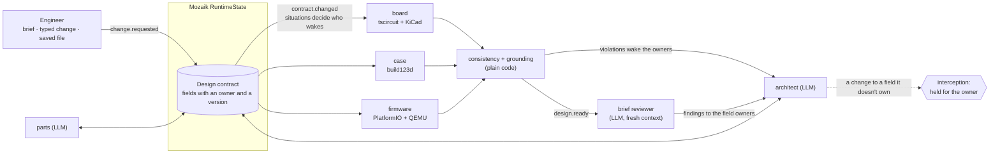

# Bringup

**Change “one thing”, and the whole hardware design follows: board, case, firmware and parts, in parallel. Even designing from scratch is just the first change.**


<sub>Recorded run, scripted agents with the real tools (tscircuit + KiCad, build123d, PlatformIO). The waiting is cut: the
ripple took 3 min 15 s.</sub>

A short product brief goes in. Concurrent [Mozaik](https://www.npmjs.com/package/@mozaik-ai/core) agents turn it into
parts with JLCPCB order numbers (stock checked live with real models), a routed PCB, a printable case whose cutouts match the board, and firmware that compiles against the
real pin map. Then the design changes, the way real designs always do, and Bringup keeps every part of it consistent. The
first design is built the same way: the beacon's took 7 contract revisions.

3ALET Hackathon 2026, Freestyle track. Built on `@mozaik-ai/core` 4.1.0.

> **Quick look: needs only Node 24, no API key; about 1 min for `npm ci`, then 10–20 s.**
> ```bash
> git clone https://github.com/Laki4Ever79/bringup && cd bringup && npm ci
> npm run bringup -- briefs/logger.md --mock --no-hardware --out out/quick
> cat out/quick/report.md   # "settled ... Violations: 0", plus the change requests held by interception
> ```

## What it does

### 1. A brief becomes a whole design

<!-- IMG docs/img/design.png: the run view, settled after the first design (agent tiles, PCB, 3D case). -->

Nine participants, each its own Mozaik loop, work at the same time against **one live design contract**. Out come
parts with LCSC numbers, a routed KiCad board, a printable case and lid, and firmware for the board's actual pin map,
booted in QEMU.

### 2. Change one thing, and only what it affects wakes up

<!-- IMG docs/img/ripple.png: mid-ripple: the change, the contract field it touched, the woken tiles lit and the idle ones dimmed, the status banner. -->

Type a change mid-run ("add a temperature/humidity sensor", "make it 40 mm wide", "the sensor is out of stock",
"blink faster when tilted"). It touches one or a few contract fields. Mozaik situations wake only the agents those fields affect; they rework their part at the same
time; plain-code checks compare what was actually built until the design is consistent again. No agent changes a field
it doesn't own: Mozaik interception holds the call until the owner approves.

**Add a sensor** (`docs/runs/add-sensor/`, scripted agents, real tools). A pocket BLE beacon with no sensor
(`briefs/beacon.md`) was designed first. Then "add a temperature/humidity sensor": the parts agent added the SHT40 and
its pull-ups, the architect wired it to GPIO8/GPIO9, the board re-placed and re-routed, the firmware switched on its
driver, and **the case cut a vent in the lid over the sensor**, because a sealed sensor measures the box, not the room.
7 of 9 agents woke; 9 conflicts were caught live (including "case has no vent over the sensor U2"), and the design was
consistent again in 195 s with 0 left. The before and after boards and cases are in the run folder.

<!-- IMG docs/img/add-sensor.png: before/after: the board with the new sensor, the lid with its vent. -->

### 3. Or just edit the file

<!-- IMG docs/img/edits.png: the drift panel / "Your edits" with Adopt and Revert. -->

Edit and save a generated file: the firmware's `pins.h`, or the board in KiCad. The save becomes the engineer's change
request and the design follows (`docs/runs/file-sync`: a pin moved in `pins.h` rebuilt the board and firmware in 96 s;
the board's edge dragged 5 mm in KiCad rebuilt the board and case in 21 s). An edit the contract can't hold, such as a
hand-routed track, is listed in the **drift panel**, where you can revert it, instead of being dropped silently; an
edit that maps to a contract field (pins, outline, connectors) can be adopted there as a change request.
`npm run bringup -- status <runDir>` (a run folder, e.g. `out/quick`) lists the same edits like `git status`.

**Link a folder, and it's a git repo** (`docs/runs/linked/`, scripted agents, real tools). `npm run bringup -- link
<runDir> <dir>` (or `--link <dir>` at the start) makes the folder a git repo, and every settled revision is one commit
by "Bringup <bringup@localhost>" whose message is the ripple: the request, the fields, who woke, the time to
consistent, the checks. Edit a file there and each edit is compared against Bringup's last commit and the design now:

| Edit | What happened |
|---|---|
| `pins.h`: I2C_SDA GPIO8 → GPIO4 | **Adopted**: commit "edited pins.h: I2C_SDA GPIO8 → GPIO4", consistent in 125 s |
| An older `pins.h` edited (I2C_SCL GPIO9 → GPIO3) while another change moved the design | **Rebased** onto the newer revision instead of refused, 45 s |
| KiCad re-saved the board: every line re-indented, every uuid re-stamped, same design | **"Re-saved, no design change"**, ignored |

It never overwrites your edits; Revert restores the committed bytes; commits are local only, never pushed. With real
models (`docs/runs/file-sync/real/`), a `pins.h` edit reached the architect as an engineer request and was applied 5 s
after the save, and the final design kept it; that run then churned and ended unsettled.

**…and it runs in a simulator** (`docs/runs/wokwi/`). After "add a temperature/humidity sensor", `npm run bringup --
simulate <runDir>` ran the new firmware in Wokwi, on a circuit generated from the contract: it printed `SENSOR OK 21.50 C
48.0 %RH` and stored the reading. The firmware the agents generated reads the sensor they chose, on the pins they
assigned. (Wokwi has no SHT40, so a small custom chip answers the datasheet's commands with fixed values.)

### 4. All the way to a real board

<!-- IMG docs/img/bench.png: a still of the ESP32-S3 on the desk, tilted, with the measured blink. -->

"Blink faster when tilted" changed the firmware's behaviour field; the firmware rebuilt, the board was flashed in 16 s
and booted, and tilted it blinked at **244 ms measured** against the 250 ms the contract asked for (`--bench real`).
An ESP32-S3 dev board stands in for the design's ESP32-C3.

## What one run hands you

| Output | Ready for | Where |
|---|---|---|
| Printable case and lid (`case.stl`, `lid.stl`, plus STEP), with a print check (minimum wall 1.6 mm, lid clearance, print orientation) and M2 standoffs that line up with the board's holes | Your own 3D printer today, or a print service | `out/<run>/enclosure/rev-N/` |
| Fab package in JLCPCB's assembly format (Gerbers + drill, `bom.csv`, `cpl.csv`, a pre-order checklist), every part an LCSC number, with stock checked live in real-model runs | Ordering the assembled PCB, with the case ordered alongside | `out/<run>/fab/` |
| Firmware, compiled against the board's actual pin map, then **booted in QEMU** (Espressif's ESP32-C3 emulator) at every revision | Flashing the real board | `out/<run>/firmware/rev-N/` |
| **SPICE power simulation** (ngspice): each regulator's output under load at the battery's low end, fed to the reviewer, which cites it (e.g. "3.277 V at 3.5 V battery, −23 mV headroom") | Catching a brown-out before it reaches a prototype | `report.md` |
| Routed KiCad board, DRC against JLCPCB's rules, a 3D render | Review in KiCad | `out/<run>/board/rev-N/` |

Every change re-makes the affected outputs: a narrower board means a new case STL, new Gerbers and new standoffs, and
nothing else.

**Ready to order in one click.** When a run is fully green (settled, consistent, real hardware, DRC clean, brief
review passed), a "Ready to order ↗" button appears on the board. One click downloads one zip with the exact files
JLCPCB asks for (`gerbers.zip`, `bom.csv`, `cpl.csv`, byte-identical to the fab package), plus `case.stl` and `lid.stl`
for JLC3DP and a README with the upload steps and a "before you pay" checklist, and opens JLCPCB's quote page.
Nothing is uploaded and no order is placed: JLCPCB has no public order API. Until the run is green the button stays
hidden, with the reason (`test/order.test.ts`).

<!-- IMG docs/img/order.png: the "Ready to order ↗" button in the board's stage bar. -->

## The proof: one change, with and without the shared contract

We applied 6 real changes to a settled design twice (`npm run experiment`, [docs/experiment.md](docs/experiment.md)).
In arm A the agents share one live design contract and Mozaik situations wake the affected ones. In arm B only the
domain that heard the change updates, and every other team keeps working from its own copy. The same plain-code checks
then compare what was actually built:

| Change | With the shared contract | Each team on its own copy: mismatches that would ship |
|---|---|---|
| Board 10 mm narrower | consistent again in 53 s · 2 of 7 woke · 0 violations | 4: two board holes have no standoff under them, two standoffs have no hole |
| Board 6 mm taller | 31 s · 2 of 7 · 0 | 5: the board is 50×30 mm, the contract says 50×36 mm, and 4 hole/standoff misses |
| USB-C to the bottom edge | 52 s · 2 of 7 · 0 | 1: the case cutout for J1 is left@15 mm, the connector is bottom@25 mm |
| Sensor I2C to GPIO4/5 | 72 s · 4 of 7 · 0 | 2: the board's I2C_SDA and I2C_SCL nets don't reach GPIO4 and GPIO5 |
| Swap the regulator for a low-Iq XC6206 | 31 s · 3 of 7 · 0 | 1: the board still places the AP2112K as U3, the contract says XC6206 |
| Add a button | 68 s · 5 of 7 · 0 | 3: the BUTTON net doesn't reach GPIO3 or SW1, the board has no SW1, and the case has no hole for it |
| **Total** | **0 violations** | **16 mismatches** |

The agents are scripted (the keyless mock models) and the tools are real: tscircuit + KiCad, build123d, PlatformIO.
Each cell is one run on one laptop, with other jobs sharing the CPU, so read the times as tens of seconds. With the
builders made to take turns instead of running in parallel, the same changes took 36–94 s instead of 31–72 s. The
regulator swap was added once a check compared the board's actual parts with the parts list; before that, it would
have scored 0 by not looking.

### With real models

| Run | Change | Touched | Woke (of 9) | Consistent again |
|---|---|---|---|---|
| real-20 | "our temperature/humidity sensor is out of stock; switch to the other one" | parts | parts, board, firmware build, grounding, consistency (5) | 75 s, after `sensor-mismatch` and `part-mismatch` were caught and cleared |
| real-20 | "make the board 40 mm wide" | outline | architect, board, case, consistency (4) | 28 s |
| real-19 | the same sensor swap | parts | 6 | 52 s, after a `sensor-mismatch` was caught and cleared |
| real-15 | "make the board 40 mm wide" | outline | 4 | 49 s |

| add-sensor-real-2 | "add a temperature/humidity sensor" | requirements, parts | 7 | 79 s; the review, judging against the brief as amended by the request, made the agents wire the sensor (I2C on GPIO6/7) |

With real models, an engineer's request now amends the brief: the reviewer stopped calling the sensor out of scope and
made the agents wire it. (In that run the parts agent had already added a sensor before the request, against the
beacon brief; the request made it legitimate. It still ended unsettled on battery life.)

Reports, ripples and full traces: `docs/runs/real-15`, `real-19`, `real-20`, `add-sensor-real-2`. Each ends with 0 violations, but **no
real-model run has passed the final brief review yet** (see [Limits](#limits)). This README does not claim results that
haven't run.

## How it works



There is no orchestrator: no agent calls or awaits another. Agents coordinate only through events and the contract.
The full diagram is in the [plan doc](https://claude.ai/artifact/GpFMaa2NAE81hn9BSHajQj).

**The contract** (`src/contract/contract.ts`). Each field has one owning role (`parts` owns `parts`, `architect` owns
the rest) and a version. A write must name the version it was based on, so when two agents write the same field at
once, exactly one applies and the other gets `stale` and re-reads.

### Every change has a checker other than its author

1. **The field's owner** approves or rejects it, through Mozaik interception (change control). An invalid proposal is
   returned with the reason before the owner is ever asked. **Approvals where you are**: a change held for the
   engineer can be pushed to a phone through [ntfy](https://ntfy.sh), with Approve and Reject buttons that decide it
   like the dashboard's. It's opt-in (off unless `BRINGUP_NTFY_TOPIC` is set), the push carries only the field and a
   one-line reason, and the phone reaches the hub only through a token-guarded decision route; a failed push leaves
   the change held. Built and tested; not yet tried on a real phone. Setup: `docs/design/phone-approvals.md`.
2. **Plain code** checks what was actually built, and grounds every pin in the catalog and KiCad's symbols.
3. **A fresh-context reviewer** judges the design against the brief.
4. **The real board**: an ESP32-S3 on the bench runs the design's firmware and reports back (`--bench real`).

| Check | What it compares | What it catches | How |
|---|---|---|---|
| **Consistency** (`src/contract/consistency.ts`) | The built artifacts against the contract | A board whose nets miss a pin assignment, a case cutout that misses the USB-C port, firmware built for another pin map, an overloaded rail | Plain code, after every build |
| **Grounding** (`src/agents/grounding-check.ts`) | The contract against the parts catalog and KiCad 10's symbol library | Invented pinouts: a pin a part does not have, a GPIO the MCU lacks, a part no source knows | Plain code, after every parts or pins change |
| **Brief reviewer** (`src/agents/reviewer.ts`) | The final design against the brief | A must-have the design does not meet, battery-life arithmetic that does not add up, a part choice that undermines the goal (for example an LDO's quiescent current against a 6-month target) | An LLM in a fresh context. It sees only the brief, the contract and the check results, never the agents' turns. |

The first two keep the design self-consistent and real. Neither asks whether it is the *right* design, so the
reviewer is the final gate. When the design is consistent and quiet, the consistency participant emits
`design.ready` instead of settling. The reviewer answers with `review.completed`. A pass settles. A fail sends each
finding to the owner of the fields it names and re-reviews the changed design. After one fix round (`maxReviewRounds`)
the run settles anyway, with the findings in `report.md`, and it is unsettled only if a blocker remains. `--no-review`
turns the gate off.

**Cross-domain checks** (`src/contract/consistency.ts`): `outline-mismatch`, `net-missing`, `pin-mismatch`,
`part-mismatch` (the board places a different part than the parts list), `sensor-mismatch` (firmware built with the
other sensor's driver), `cutout-missing`, `cutout-misaligned`, `standoff-mismatch` (case standoffs vs board holes),
`rail-overload`, `firmware-build-failed`. Each check reads the artifacts that
were actually built. For example, the firmware's pins are parsed back out of the `pins.h` it compiled.

**Events** (`src/events.ts`):

| Event | Meaning |
|---|---|
| `contract.changed` | A field got a new version: field, version, revision, by whom, the writer's own `reason`, `before`/`after`, and the `cause` that woke it (the brief, an engineer request, a violation, a review finding, a failed build, an approval). The dashboard's "What changed & why" drawer reads this |
| `change.proposed` | A non-owner asked to change a field; its loop is held |
| `change.decided` | The owner approved or rejected it |
| `artifact.ready` / `artifact.failed` | A board, enclosure or firmware build finished for a revision |
| `consistency.checked` | Cross-domain check result, with each violation's `affects` roles |
| `grounding.checked` | Part pins and pin assignments checked against the catalog and KiCad symbols |
| `design.ready` | The design is consistent and quiet; the brief reviewer judges it before it settles |
| `review.completed` | The reviewer's verdict (`pass`/`fail`) with findings, each naming the contract fields it concerns |
| `design.settled` | Every artifact is built against the latest revision with no violations, and the review is done |
| `change.requested` | An engineer's mid-run change request (`req-N`), from the dashboard, the CLI's `--change`, `src/request.ts` or the MCP server. Its ripple ends at the next `design.ready` |
| `firmware.booted` | The newest firmware booted in QEMU and printed its revision |
| `bench.*` | The real board: `flashing`, `flashed`, `telemetry`, `blink` (LED period measured from telemetry), `instruction` ("tilt the board"), `measured`, `verdict` |
| `agent.halted` | An agent loop crashed (Mozaik #114 workaround) |
| `run.ended` | A run kept up with `--stay` or `--bench` was stopped |
| `change.requested` from a file | A saved generated file whose edit maps to the contract becomes a change request with `source: {kind: "file", path, revision, items}` |
| `file.drift` | An edit outside the contract, or a save against an older revision: `path`, `savedRevision`, `designRevision`, `reason`, `items`, `message` |
| `drift.resolved` | A drift entry was adopted (as a change request) or reverted |

## How it uses Mozaik

| Mozaik feature | How Bringup uses it | Where |
|---|---|---|
| `SituationSpecification` + processor | Each participant's situations decide which events wake it, so **the situations are the dependency graph between domains** | `src/change-control.ts` (`when`, `ownerReviewsChanges`) |
| `runLoop` (fire-and-forget) | Every agent turn is its own loop, so agents run concurrently; each turn starts from a fresh context | `src/agents/common.ts` (`startTurn`) |
| `RuntimeState` | `BringupState` holds the contract, artifacts, roles and open approvals: one shared state per run | `src/runtime.ts` |
| `InterceptionHandler` | **Change control**: a `propose_contract_change` call on a field the agent doesn't own is held mid-loop until the owner decides; rejections go back to the model as the tool output | `src/change-control.ts` (`ChangeControl`) |
| `createHuman` | Plain-code participants with no LLM: the change desk routes decisions to held loops, the consistency checker, the grounding critic, the three builders, and the engineer who sends the brief | `src/change-control.ts`, `src/agents/consistency.ts`, `src/agents/critic.ts`, `src/agents/builders.ts`, `src/run.ts` |
| Custom `InferenceRunner` | Per-role models (strong for architect, fast for the rest). `--mock` swaps in a scripted runner, so a full run needs no key | `src/inference/models.ts`, `src/inference/scripted-runner.ts` |

Workarounds for known 4.1 bugs:

- **#115** (`publish` is re-entrant, so participants can see events in different orders): every custom event goes
  through an `Outbox` that delivers one event at a time and writes `trace.jsonl`. See `src/outbox.ts`.
- **#114** (`runLoop` swallows errors, so a crashed agent looks idle): `safeRunLoop` turns failures into
  `agent.halted`. See `src/runtime.ts`.
- **#113** (an interception returning `idle` crashes): `ChangeControl` never returns `idle`.

Long tool runs are coalesced per artifact by `Rebuilder` (`src/tools/rebuilder.ts`). There is one build at a time; if
the inputs change mid-build, exactly one more build runs at the newest revision.

## Install

The Quick look above needs only Node. The full toolchain adds real board, enclosure and firmware builds, and it is
three commands after the clone:

```bash
npm ci              # about 12 s
npm run setup       # installs only what's missing; about 13.5 min the first time (plus about 4 min for the KiCad
                    # image download on a new machine), about 2 s on a re-run
npm run doctor      # about 5 s: what each tool will use, and which optional settings are set (never their values)

npm run bringup -- briefs/beacon.md --mock    # then: scripted models, real tools; settled with 0 violations in 131 s
```

`npm run setup` first checks the prerequisites and says plainly what's missing (Node 24, uv, and a Docker daemon that
works without `sudo`: "Docker isn't running: start it, then re-run"). It installs the same pinned versions as the
manual steps below, all repo-local (`.venv/`, `tools/`), never with `sudo` and never system-wide. Optional:
`npm run setup -- --qemu` adds firmware emulation (QEMU), and `npm run setup -- --wokwi` adds Wokwi simulation (the
pinned CLI, checked by sha256, plus the stand-in sensor chips; linux-x64; about 44 s, plus a ~360 MB toolchain download
into `~/.wokwi` on a new machine), plus `WOKWI_CLI_TOKEN` in `.env`. A fresh machine takes about 20 min end to end (checked on a fresh
clone on 31 Oct; every step exited 0).

| Prerequisite | Tested with | Notes |
|---|---|---|
| Linux x86-64 (macOS should work, but is untested) | Ubuntu, kernel 7.0 | |
| Node 24 + npm | Node 24.0.2, npm 11.3.0 | the only requirement for `--no-hardware` |
| [uv](https://docs.astral.sh/uv/) + Python 3.12 | uv 0.10.2, CPython 3.12.3 | for build123d and PlatformIO |
| Docker, with the daemon running and usable without `sudo` | Docker 29.6.1 | for KiCad and ngspice |
| Disk | about 9.6 GB | `.venv` 0.9 GB, `tools/node` 0.8 GB, KiCad image 2.6 GB, `~/.platformio` about 5.3 GB (1.1 GB of it a download cache you can delete) |
| Java 17+ (optional) | | only for the Freerouting fallback |

**Optional settings** go in `.env` (copy `.env.example`): a model key for real models, `WOKWI_CLI_TOKEN` for Wokwi
simulation, `BRINGUP_NTFY_TOPIC` (unguessable) / `BRINGUP_NTFY_SERVER` for phone approvals.

<details>
<summary>The same install by hand (what <code>npm run setup</code> runs)</summary>

```bash
npm ci
uv venv --python 3.12 .venv && uv pip install platformio==6.2.0 build123d==0.13.0
npm i --prefix tools/node tscircuit@0.0.3042 bun@1.4.4    # pinned: tscircuit releases daily; ERESOLVE peer warnings are expected
docker pull kicad/kicad:10.0                              # kicad-cli 10 and ngspice; 0.8 GB download, a few minutes
.venv/bin/pio pkg install -d templates/fw -e esp32c3      # ESP32-C3 toolchain + libraries into ~/.platformio, about 4 min
```

Repo-local installs go in `.venv/` and `tools/node/`, both gitignored. The exceptions are PlatformIO's package cache
(`~/.platformio`) and Docker's image store. The last command downloads the toolchain up front, so the first run
doesn't stall on it. Without it, the first firmware build downloads it and takes several minutes; later builds take
about 5 s. `-e esp32c3` matters: without it PlatformIO also fetches the ESP32-S3 toolchain for the bench build.

</details>

Optional: Espressif QEMU, to boot the built firmware headless. Install steps are in `NOTES.md` ("Firmware emulation").

Optional: **Wokwi firmware simulation**, to run the firmware with a simulated sensor. Create a free token at
[wokwi.com/dashboard/ci](https://wokwi.com/dashboard/ci), add `WOKWI_CLI_TOKEN=…` to `.env`, and run
`npm run setup -- --wokwi` (or install by hand as `NOTES.md` describes, "Optional: Wokwi firmware simulation"). The free plan has 50 simulation minutes a month, so
simulation runs on demand, not on every build.

**Environment detection** (`src/tools/env.ts`). At start, Bringup picks a backend for each tool from what the machine
has, with repo-local tools first: `tools/node/.../tsci`, `.venv/bin/python`, `.venv/bin/pio`, and a local `kicad-cli`
or else the `kicad/kicad:10.0` Docker image. A missing tool turns into an `artifact.failed` event with a clear
message, not a crash.

## Run

```bash
# Fastest look, with nothing but `npm ci`: scripted models, hardware stubbed. 10–20 s (5 s on an idle machine).
npm run bringup -- briefs/logger.md --mock --no-hardware

# Skip the brief reviewer gate (the consistency and grounding checks still run)
npm run bringup -- briefs/logger.md --mock --no-review

# No API key needed: scripted models, real tools. About 1–3 min once the tools are installed.
npm run bringup -- briefs/logger.md --mock

# Real models: copy .env.example to .env and set one of
#   OPENAI_API_KEY=...
#   ANTHROPIC_API_KEY=... and ANTHROPIC_BASE_URL=...   (the event's Claude credit, build.jigjoy.ai/credits)
npm run bringup -- briefs/logger.md
```

**Change one thing yourself.**

```bash
# The demo: the dashboard opens, the first design settles, then "make it 60 mm wide" goes in and ripples.
# The run stays up afterwards: type your own change in the dashboard ("make it 40 mm wide"). Stop ends it.
npm run demo

# With nothing but `npm ci` (hardware stubbed): the same settle → change → ripple → consistent story, in about 10 s.
npm run demo -- --no-hardware

# The same from the CLI: each --change is sent after the design settles, and the run ends once the last one re-settles.
npm run bringup -- briefs/logger.md --mock --change "make the board 40 mm wide"

# Dashboard for any run, live or finished (http://localhost:4317; if that port is taken it picks a free one and
# prints the URL, or pass a port: `npx tsx src/dashboard/cli.ts out/quick 4400`)
npx tsx src/dashboard/cli.ts
```

Each change gets a row in `ripples.json` and in the report's "Change requests" table: the contract fields it touched,
the agents that reworked something, the ones that only checked it, the ones that stayed idle, and the time until the
design was consistent again. The scripted agents understand "N mm wide" and "blink faster when tilted". Use real
models for anything else.

**Simulate the firmware with its sensor** (optional; needs `WOKWI_CLI_TOKEN`, see Install). The simulated circuit is
generated from the contract: the ESP32-C3 plus the sensor the agents chose, on the pins they assigned. Without a token
it reports "not run" and nothing fails.

```bash
npm run bringup -- simulate <runDir>
```

**Link a folder** (it becomes a git repo with one commit per settled revision; edit files there):

```bash
npm run bringup -- link <runDir> <dir>
```

**Edit a generated file.** On a run that stays up (`npm run demo`, or `--stay`), save an edited `firmware/rev-N/include/pins.h`
or `board/rev-N/dist/board/kicad/board.kicad_pcb`: a pin, outline or connector change becomes a change request and
ripples like a typed one. Anything else shows up in the dashboard's drift drawer, with Adopt (for edits that map to a
contract field) and Revert.

```bash
# What was edited by hand in a run folder, like git status: open, adopted or reverted, with the diff lines
npm run bringup -- status out/quick
```

`--no-hardware` swaps the three builders for stubs (`src/tools/stubs.ts`). Each stub derives its artifact straight
from the contract: board nets from the pin map, enclosure cutouts from the connectors, firmware pins from the pin
map. The agents, change control, the grounding check and the consistency checks all run as usual, and the report
says the hardware was stubbed. Without `--no-hardware`, a missing tool is a warning: its build fails with
`artifact.failed`, and the run ends unsettled. The report then opens with a "Missing tools" section listing what to
install.

Each run writes everything under `out/<runId>/`. `<runId>` is a UTC timestamp such as `20261031-142530`, or you can
choose the folder with `--out <dir>`. The last line of the run prints the report's path.

| Path | Contents |
|---|---|
| `report.md` | Start here: settled or not, violations, the brief review verdict and findings, changes proposed, held, approved and rejected, tool table |
| `contract.json` | The final design contract |
| `brief.md` | The brief the run started from |
| `board/rev-N/` | One folder per build: `board.circuit.tsx`, KiCad project (`dist/board/kicad/board.kicad_pcb`), `board.step`, `board.png`, `fab/`. The latest render is also at `board/board.png` |
| `fab/` | The latest board's fab package in JLCPCB's assembly format (PCBWay takes it too): `gerbers.zip` (9 layers + Excellon drill), `bom.csv`, `cpl.csv`, and `README.txt` with a checklist of what to verify before ordering. Skipped under `--no-hardware` |
| `enclosure/rev-N/` | `case.step`, `case.stl`, `cutouts.json` |
| `firmware/rev-N/` | PlatformIO project with the generated `include/pins.h` |
| `trace.jsonl` | Every event in delivery order |

Exit codes: 0 when settled with no violations, 2 when unsettled (including when a hardware tool is missing), and 1 on
bad arguments.

Dashboard: `npx tsx src/dashboard/cli.ts out/<runId>`.

**Design tournament.** Run several variants of one brief at the same time, each in its own process, then rank them:

```bash
npm run tournament -- briefs/logger.md --variants briefs/variants-logger.json --mock
```

A variant is a short constraint appended to the brief, for example "Board must be at most 40 mm wide". Results go to
`out/tournament-<ts>/<variant>/`, one full run each, plus `scoreboard.json` and `scoreboard.md`. The ranking puts
settled designs first, then fewest violations, then BOM cost (live JLCPCB prices), then board area. It needs the full
toolchain. With the four example variants and `--mock`, all four settle with 0 violations in about 80 s of wall time
for the four concurrent runs. The 40 mm board ranks first on board area. The BOMs tie, because the scripted models
pick the same parts for every variant.

## Use from Claude Code

Bringup is also an MCP server (stdio), so a coding agent can start runs and read their results. Register it from
the repo root:

```bash
claude mcp add bringup -- "$PWD/node_modules/.bin/tsx" "$PWD/src/mcp/cli.ts"
```

Tools: `start_design {brief, mock?}` starts a run in the background and returns its `runId` at once (`mock` defaults to
true: scripted models, no API key). `design_status`, `read_contract`, `get_report` and `list_events {sinceSeq?}` read
`out/<runId>/`. Cursor and other MCP clients take the same command. Set `BRINGUP_OUT` to keep runs somewhere other than
`out/`.

## Tests

```bash
npm test             # node:test via tsx; unit and integration tests
npm run typecheck
```

Integration tests (`*.int.test.ts`) run the real tools (tscircuit + KiCad, build123d, PlatformIO, ngspice, QEMU)
against a reference ESP32-C3 + SHT40 logger (`test/fixture.ts`). Each one **skips** when its tool is missing, so
`npm test` passes on a bare checkout:

| Checkout | Result | Time |
|---|---|---|
| After `npm ci` only | all pass; the tool-dependent integration tests skip | about 20 s |
| Full toolchain | all pass; only the 3 QEMU tests skip (QEMU is optional) | about 2 min; 3 min 15 s with QEMU |

## Prior art and what's new

The pieces are not new on their own. We credit:

- **[Odem](https://www.producthunt.com/posts/1263017)**: "Cursor for hardware", parts to PCB to enclosure to firmware.
- **[MeshCue Forge](https://github.com/meshcue/meshcue-forge)**: one spec as the source of truth, with a cross-domain DRC
  for pin conflicts, power budget and enclosure cutouts.
- **[Copperhead](https://github.com/copperheadhq/copperhead)**: a gated KiCad agent where doc drift fails the build.
- **[DRCY](https://arxiv.org/abs/2603.15672)**: multi-agent datasheet review of schematics.
- **[Engineering Studio AI](https://lablab.ai/ai-hackathons/nativebuilder-build-without-limits/x-dark-x/engineering-studio-ai-multi-agent-design-system)**:
  parallel agents with disagreement reconciliation.
- **[tscircuit](https://tscircuit.com)** (circuits as code, autorouting) and **[KiCad](https://www.kicad.org)** (DRC,
  ERC, exports), which do the real EDA work.

What Bringup adds is **change propagation**: change one thing mid-run and only the affected domains wake, rework in
parallel and converge, with the checks running **live as events** instead of as a final pipeline stage. Contract
fields have **owners and versions**, and cross-owner edits go through **change control built on Mozaik
interception**, the way engineering change orders work. Flux described this as a vision in September 2026 ("moving
a connector 5 mm means the ME changes the enclosure and the EE changes the PCB"); Siemens' Fuse EDA agent orchestrates
chip and PCB tools but not the case or firmware. The A/B experiment above measures what the shared contract buys.

## Limits

- **Review before ordering.** The logger is electrically complete: Li-ion charger and battery connector, USB-C CC
  pull-downs, D± to the ESP32-C3's native USB, I2C pull-ups and bypass caps. Each run exports a fab package. It is
  still not fab-ready without a human pass:
  - the ESP32-C3-MINI-1 land pattern has approximate pad offsets, and only one of its GND pads is wired
  - there is no ground pour
  - the SHT40 and the button use stand-in footprints
  - the TP4054 pin order comes from the pin-compatible LTC4054
  - JST-PH battery polarity varies between packs

  `fab/README.txt` lists every item to check; `catalog/README.md` has the details.
- **Small boards only.** Placement and routing are proven on 45–70 × 30 mm boards with up to about 20 parts.
- **QEMU is optional.** It is not installed by default; without it the report says "not run" and the QEMU tests
  skip. Installed, every run boots its newest firmware to `bringup rev N` (event `firmware.booted`). There is no SHT40
  in emulation, so the firmware then prints `SENSOR FAIL`. With a Wokwi token, `simulate` runs the firmware with a
  stand-in sensor chip that answers with fixed values (not a real sensor), on demand rather than on every build. The
  product firmware deep-sleeps between readings; QEMU doesn't emulate the timer wake, so that part is untested.
- **BLE is verified on a dev board, not on the design.** The product firmware advertises for the wake window the
  battery maths assumes and serves the latest reading and the history over a GATT service (NimBLE 2.5.2). On the
  desk's ESP32-S3, a laptop found it and read the latest reading and the history; no real sensor was fitted, and
  connection hold with a phone is untested.
- **No real-model run has passed the final brief review yet.** Real runs 15, 19 and 20 took mid-run changes and ended
  with 0 violations, but the fresh-context reviewer still blocked. Its open points in real-20: it reads the bench-only
  `behavior` field as the product LED (one field meaning two builds), it calls two rails' stated averages
  double-counted, and in one round it caught a 250 mA charge current that is too high for a 500 mAh cell. Each report
  lists what's open.
- **File sync reads a few fields back.** A saved `pins.h` (pin numbers) and a saved `board.kicad_pcb` (outline,
  connector positions) map to the contract; other edits are reported as drift and never applied. It doesn't import an
  arbitrary existing KiCad project. The sync runs used scripted agents with the real tools; the one real-model run
  took the edit but ended unsettled.
- **Stock is live, the catalog is small.** The part selector checks live JLCPCB stock and price by LCSC number, but it
  can only choose from the vetted catalog (one MCU family, two temperature/humidity sensors today).
