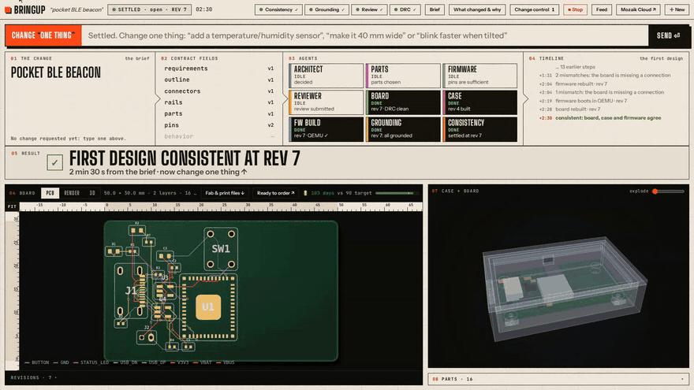
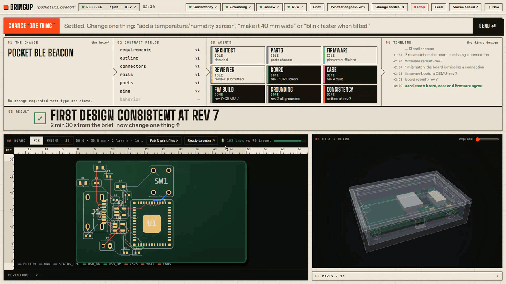
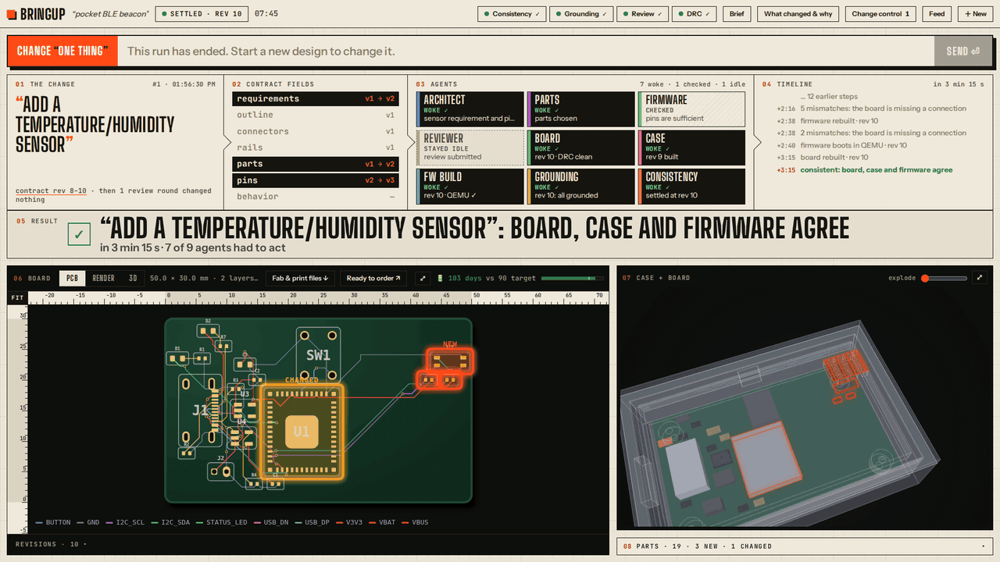
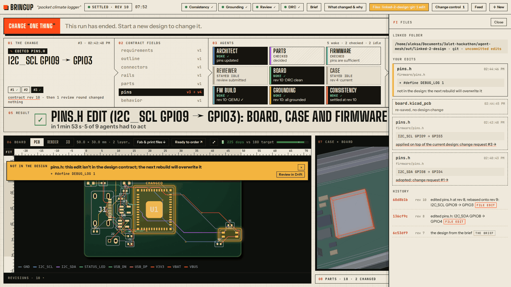

# Bringup

**Change “one thing”, and the whole hardware design follows: board, case, firmware and parts, in parallel.**

**▶ Watch the 3-minute demo: [youtu.be/b0B6R5KyZ64](https://youtu.be/b0B6R5KyZ64)**



<sub>Recorded run, scripted agents with the real tools (tscircuit + KiCad, build123d, PlatformIO). The waiting is cut: the
ripple took 3 min 15 s.</sub>

A short product brief goes in. Concurrent [Mozaik](https://www.npmjs.com/package/@mozaik-ai/core) agents turn it into
parts with JLCPCB order numbers, a routed PCB, a printable case whose cutouts match the board, and firmware that
compiles against the real pin map. Then the design changes, the way real designs always do, and Bringup keeps every
part of it consistent. Even designing from scratch is just the first change: the beacon's first design took 7 contract
revisions.

Bringup is a demonstrator for one product family: ESP32-C3 boards built from a small, vetted parts catalog.
3ALET Hackathon 2026, Freestyle track. Built on `@mozaik-ai/core` 4.1.0. Full details: [docs/details.md](docs/details.md).

**The fastest way to see it: [bringup-demo.onrender.com](https://bringup-demo.onrender.com/)**, nothing to install. A read-only dashboard of recorded
runs (the first load after idle takes about 30 s), or press **Try it**: a stubbed scripted run you can change once
("add a temperature/humidity sensor"). The recorded runs used the real tools; live runs there are stubbed, because
the real toolchain (KiCad in Docker, the ESP32 compiler, about 9.6 GB and minutes of full CPU per build) doesn't fit a
free web host. [Why, in detail](docs/details.md#why-the-live-demo-is-stubbed).

## What's real, what's scripted

| Part | In the quick look | In the recorded runs (`docs/runs/`) | On the live site | Locally, fully installed |
|---|---|---|---|---|
| Agents | scripted | scripted (most) · real models (`real-*`, `add-sensor-real*`) | scripted | scripted or real models (your key in `.env`) |
| Board, case, firmware builds | stubbed | real tools | real tools (recorded) · stubbed (Try it) | real tools |
| Checks (consistency, grounding) | real | real | real | real |
| Final brief review | scripted | scripted or a real model | scripted | scripted or a real model |
| The ESP32 board | none | bench runs only | none | `--bench real` |

## Quick look (Node 24 only, no API key, about 1 min)

```bash
git clone https://github.com/Laki4Ever79/bringup && cd bringup && npm ci
npm run bringup -- briefs/logger.md --mock --no-hardware --out out/quick
cat out/quick/report.md   # "settled ... Violations: 0", plus the change requests held by interception
```

This quick look stubs the hardware tools, so it builds no board or case. To see what the real tools produce without
installing them, open the recorded run [docs/runs/add-sensor/](docs/runs/add-sensor/): its board renders
(`board/rev-10/board.png`), the printable case and lid (`enclosure/rev-9/*.stl`, which GitHub shows in 3D), the
report and the full trace.

**Words used below.** *Contract*: the one shared design every agent reads and writes. *Settled*: every built file
matches the contract and nothing is left to do. *Grounding*: checking every part and pin against the parts catalog and
KiCad's symbol library. *Brief reviewer*: an AI that judges the finished design against the original brief, with none
of the agents' history.

## What it does

### 1. A brief becomes a whole design



Nine participants, each its own Mozaik loop, work at the same time against **one live design contract**: parts with
LCSC numbers, a routed KiCad board, a printable case and lid, and firmware for the real pin map, booted in QEMU.

### 2. Change one thing, and only what it affects wakes up



"Add a temperature/humidity sensor": the parts agent added the SHT40, the architect wired it, the board re-routed, the
firmware switched on its driver, and **the case cut a vent over the sensor**. 7 of 9 agents woke, 9 mismatches were
caught live, and the design was consistent again in 195 s (`docs/runs/add-sensor/`, scripted agents, real tools).

### 3. Or just edit the files yourself



Save an edited `pins.h` or the board in KiCad, and the save becomes a change request: the rest of the design follows. A
linked folder is a git repo with one commit per settled revision; an edit the contract can't hold is flagged, never
silently overwritten (`docs/runs/file-sync/`, `docs/runs/linked/`).

### 4. All the way to a real board, and ready to order

"Blink faster when tilted" changed only the firmware; the real board was reflashed in 16 s and, tilted, blinked at
**244 ms measured** against the 250 ms asked (an ESP32-S3 dev board standing in for the design's ESP32-C3). Every run
hands you case and lid STLs, a JLCPCB fab package and firmware; on a fully green run, **Ready to order** zips exactly
the files JLCPCB asks for and opens the quote page (nothing is uploaded or ordered).

## Architecture


There is no orchestrator: no agent calls or awaits another. How it uses Mozaik:

- **`RuntimeState`** holds one live design contract per run; every field has an owner and a version.
- **Situations are the dependency graph**: each participant's situations decide which changes wake it.
- **`runLoop`** is fire-and-forget, so every agent turn runs concurrently with the others.
- **`InterceptionHandler` is change control**: a change to another owner's field is held mid-loop until the owner decides,
  and owners do say no: in real run 7 interception held 18 changes and the owners rejected 8 ([docs/runs/real-7](docs/runs/real-7/report.md)).
- **Plain-code participants** (builders and checks) and a custom `InferenceRunner` (`--mock` runs with no key).

Events, checks, the full Mozaik table and our 4.1 workarounds (#113, #114, #115) are in [docs/details.md](docs/details.md).

## Install & run

```bash
npm ci              # about 12 s
npm run setup       # the full toolchain, repo-local; installs only what's missing (about 14 min the first time)
npm run doctor      # what each tool will use, and which optional settings are set (never their values)
npm run demo        # the dashboard opens, a design settles, a change ripples; type your own change after it

npm run bringup -- briefs/beacon.md --mock                                    # scripted models, real tools
npm run bringup -- briefs/logger.md --mock --change "make the board 40 mm wide"   # a change from the CLI
npm run bringup -- briefs/logger.md                                           # real models: a key in .env
```

Prerequisites: Linux x86-64, Node 24, [uv](https://docs.astral.sh/uv/), and Docker usable without `sudo`; about 9.6 GB
of disk. `npm run setup` checks them first and says plainly what's missing. Optional settings go in `.env` (copy
`.env.example`). The manual install steps, every command (link, status, simulate, tournament, MCP), the run folder and
the tests are in [docs/details.md](docs/details.md).

## Honest status

- Scripted runs settle with 0 violations and take mid-run changes, with the real board, case and firmware tools.
- Real models take mid-run changes too (run 20: a sensor swap rippled to consistent in 75 s, 40 mm wide in 28 s;
  that run as a whole then failed the final review and did not settle).
- **A real-model run has passed the final brief review**: run real-pass ([docs/runs/real-pass](docs/runs/real-pass/)) designed the beacon from its brief with real models and real tools, failed review 1, fixed itself, and passed review 2 (settled at rev 19, 0 violations, about 8 minutes). It is 1 pass out of 21 real runs started that night; the others ended unsettled. What got it there: the designers now see the same computed facts as the reviewer, and the review's computable checks run live during design.
- Boards need a human review before ordering (`fab/README.txt` lists every item); the parts catalog is small.

## Credits

Prior art we credit: Odem, MeshCue Forge, Copperhead, DRCY, Engineering Studio AI; tscircuit and KiCad do the real EDA
work. What Bringup adds is change propagation across board, case, firmware and parts (details and links in
[docs/details.md](docs/details.md#prior-art-and-whats-new)).
