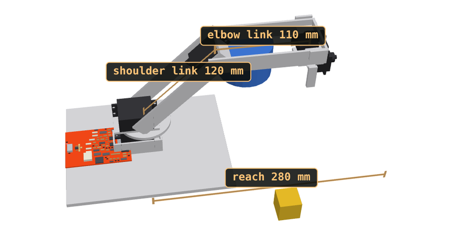

# Bringup

**Describe a circuit board or a whole robot in a few sentences. Bringup designs it: a custom PCB, the printed parts,
the firmware and the parts list.**

- **Custom PCBs**: the schematic and a routed board, with Gerbers, BOM and pick-and-place files in JLCPCB's format, a
  case whose cutouts match the connectors, and firmware that compiles against the real pin map.
- **Entire robots**: everything above, plus the chassis and mounts as printable parts (STL, STEP), the motors, battery
  and sensors chosen and checked against each other, the robot's own firmware driving a physics model of it in
  simulation, and a ROS 2 package.

**Change “one thing”, and the whole design follows: board, printed parts, firmware and parts, in parallel.**


<sub>A recorded run with the real tools, shown in Bringup's hosted page; the waiting is cut. ▶ [3-minute demo video](https://youtu.be/b0B6R5KyZ64)</sub>

## Free and open, plus Bringup Studio

The engine is open source and free: it runs on your machine and every file it makes is yours. Bringup Studio, the
hosted page where you watch and steer a design live, is the paid part, the way Mozaik pairs its open framework with
Mozaik Cloud.

| Free and open source (this repo, Apache-2.0) | Bringup Studio (paid, coming soon) |
|---|---|
| The engine, the agents, every check, the CLI and the MCP server | The live 3D robot and its simulation in 3D |
| Every file a design produces: KiCad project, Gerbers, BOM, pick-and-place, STL/STEP, firmware, URDF and ROS 2, the report | Editing on the design itself: click a part, change it, watch the change ripple |
| Still pictures of the board and the robot in the build package | Logs and debugging: the timeline, why each change happened, every agent's trace |
| | Run history, sharing and teams, with nothing to install |

## Quick start

Needs Node 22 or later. Nothing else to install first.

1. **Add Bringup to your AI client and ask for a design.** In Claude Code:

   ```bash
   claude mcp add bringup -- npx -y bringup-mcp
   ```

   Then ask, for example, "design a BLE temperature logger, USB-C, 50x30 mm". The first `npx` downloads about 185 MB
   (about 15 s). Without the hardware tools, the agents still design the whole contract (parts, pins, outline) and run
   every check, and the reply says what one command would add. Cursor, Claude Desktop and other clients:
   [docs/mcp.md](docs/mcp.md).

2. **Real boards with pictures** (from 0.2.3): `npx -y bringup-mcp setup board`, about 923 MB and 30 s, once. The next
   design builds a routed board, its JLCPCB fab files (Gerbers, BOM, pick-and-place) and pictures of it: a 3D view,
   the PCB and the schematic. On a clean machine that design took 45 s.

3. **The rest, when you need it** (from 0.2.3), one domain at a time, installed into `~/.bringup`:

   | Command | Size, once | Adds |
   |---|---|---|
   | `npx -y bringup-mcp setup board` | ~923 MB, ~30 s | routed boards, fab files and their pictures |
   | `npx -y bringup-mcp setup case` | ~945 MB, ~75 s | cases, robot chassis and printed parts (STEP, STL); needs the system's OpenGL library, `sudo apt install libgl1` on a minimal Linux |
   | `npx -y bringup-mcp setup firmware` | ~125 MB, then ~1 GB on the first firmware build | firmware compiled against the board's real pins |
   | ROS 2 (robots) | comes with `setup case` | a ROS 2 Jazzy workspace in the build package (URDF, ros2_control, Nav2, launch); build it with colcon on Ubuntu 24.04 with ROS 2 Jazzy: [docs/ros.md](docs/ros.md#from-npm-no-clone) |

   `npx -y bringup-mcp setup` lists them and installs nothing. On Windows, Defender scans every file the board tools
   unpack, so `setup board` takes 2–3 min there (24 s on GitHub's Windows runner with the scan excluded); to speed it up,
   exclude `%USERPROFILE%\.bringup` in Windows Security, Virus & threat protection, Exclusions. With Docker, Bringup builds everything in its own
   toolchain image instead (a few GB, once).

4. **Bringup Studio** (from 0.2.3): `npx -y bringup-mcp login --url <studio address>` connects this machine, and every
   run streams there ([docs/studio.md](docs/studio.md)). Designing, every file and every change's ripple stay free;
   Studio adds editing, the 3D simulation, debugging and run history.

## From source

```bash
git clone https://github.com/Laki4Ever79/bringup && cd bringup
npm ci
npm run setup -- --robotics                 # the whole toolchain, repo-local; drop --robotics for boards only
npm run bringup -- briefs/rover.md --mock   # a robot from its brief, no API key needed
```

Needs Linux x86-64, Node 24, [uv](https://docs.astral.sh/uv/), Docker without `sudo`, and libGL and SDL2 (a desktop has
them; on a minimal system, the `libgl1` and `libsdl2-2.0-0` packages); `npm run setup` checks them and says what's missing.
On a new machine (an empty container, 22 Nov 2026) setup took 5 min and the rover then settled in 4 min, its simulated
drive passing. Every design's files land in its run folder: the board (KiCad, Gerbers, parts list), the printed parts
(STL, STEP), the firmware, the ROS description and the report. A board-only brief works the same way, for example
`npm run bringup -- briefs/logger.md --mock`.

## What you get

From a short brief (a board: [the climate logger](briefs/logger.md); a robot: [the Eurobot base](briefs/eurobot-base.md)):

- **A custom PCB**: parts with JLCPCB order numbers, a schematic and a routed board, and the fab package (Gerbers, BOM,
  pick-and-place) to order it; a case whose cutouts match it when the design needs one.
- **An entire robot**: the chassis and mounts as printable parts, the motors, battery and sensors chosen and checked,
  the robot's own firmware driving a physics model of it in simulation, and a ROS 2 package.
- **Firmware** that compiles against the real pin map.
- **A parts list** with live stock and prices, and a build package with the assembly steps.
- **Checks** across all of it: wiring, power, motor and battery currents, parts that collide, the competition's rules.

## Robots

**A rover** ([briefs/rover.md](briefs/rover.md)): the board, the chassis as printable parts (STL, STEP), the motors,
wheels, battery and distance sensor chosen and checked against each other, the robot's own firmware driving a physics
model of it in simulation, and a ROS 2 Jazzy workspace: the URDF, ros2_control and Nav2 settings, launch files and the
hardware plugin that talks to the firmware ([docs/ros.md](docs/ros.md#from-npm-no-clone)). From the Quick start it needs
`setup board case`; on a clean machine the rover settled in 5–8 min.


**A desktop arm** ([briefs/arm.md](briefs/arm.md)): six hobby servos on its own board, the base, brackets, wrist and
gripper as printable parts checked for collisions across the joints' range and for printability, its firmware picking a
cube and dropping it into a cup in simulation (5 of 5 in the acceptance test), and its URDF and controllers.



## How it works

Concurrent [Mozaik](https://www.npmjs.com/package/@mozaik-ai/core) agents (electronics, mechanics, firmware, parts) work
on one live design contract. A change to one field wakes only the agents it affects, plain code checks every change
across domains, and the real tools (tscircuit and KiCad, build123d, PlatformIO, QEMU, MuJoCo) build every revision.

Status: scripted and real-model runs settle with 0 violations on the real tools; no board or robot has been built yet,
so a prototype order is next.

## More

- [docs/overview.md](docs/overview.md): robots in detail, every feature, the architecture, the honest status
- [docs/details.md](docs/details.md): every command, the run folder, the tests, the manual install
- MCP server (use Bringup from Claude Code, Cursor or any MCP client): `claude mcp add bringup -- npx -y bringup-mcp`, see [docs/mcp.md](docs/mcp.md)
- [CONTRIBUTING.md](CONTRIBUTING.md)

## License

Apache-2.0 (see [LICENSE](LICENSE) and [NOTICE](NOTICE)).

## Credits

Built on [Mozaik](https://www.npmjs.com/package/@mozaik-ai/core) (`@mozaik-ai/core` 4.1.0, by [JigJoy](https://jigjoy.ai)): every agent is a Mozaik participant, and the live design contract is Mozaik's shared `RuntimeState`.

Prior art we credit: Odem, MeshCue Forge, Copperhead, DRCY, Engineering Studio AI, text-to-cad (exact interference, prompt references, URDF checks: the ideas) and cadsmith (py/parts/: ISO fits and holes, servos, motors, bearings, fasteners and gears with named frames, ported under its MIT License, py/parts/LICENSE); tscircuit and KiCad do the real EDA
work. What Bringup adds is change propagation across board, case, firmware and parts (details and links in
[docs/details.md](docs/details.md#prior-art-and-whats-new)).
