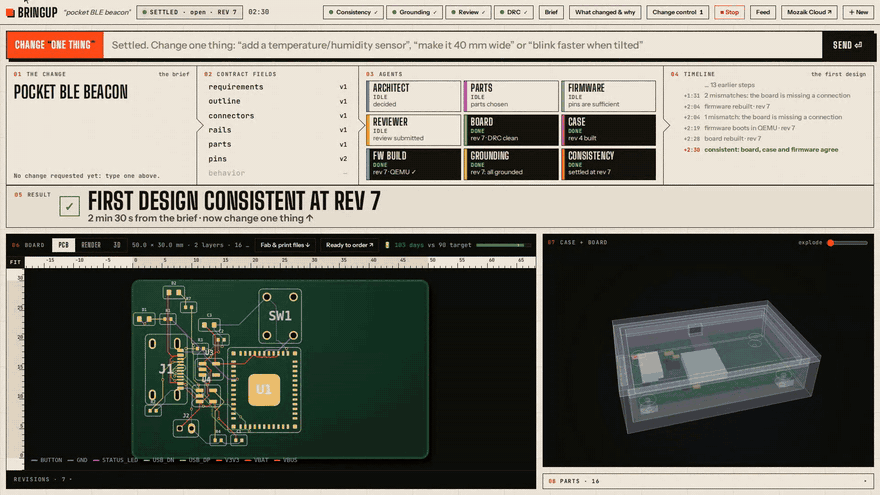

# Bringup

**Change “one thing”, and the whole hardware design follows: board, printed parts, firmware and parts, in parallel.**



<sub>A recorded run with the real tools; the waiting is cut. ▶ [3-minute demo video](https://youtu.be/b0B6R5KyZ64)</sub>

## Install & run

```bash
git clone https://github.com/Laki4Ever79/bringup && cd bringup
npm ci
npm run setup -- --robotics                 # the whole toolchain, repo-local; drop --robotics for boards only
npm run bringup -- briefs/rover.md --mock   # a robot from its brief, no API key needed
```

Needs Linux x86-64, Node 24, [uv](https://docs.astral.sh/uv/) and Docker without `sudo`; `npm run setup` checks them
and says what's missing. Then try `npm run dashboard` (describe a device, build it, explore it in 3D).

## What you get

From a short brief (for example [the Eurobot base](briefs/eurobot-base.md)):

- **Robots**: the chassis and mounts as printable parts, the motors, battery and sensors chosen and checked, and the
  robot's own firmware driving a physics model of it in simulation, with a ROS 2 package.
- **Boards**: parts with JLCPCB order numbers, a routed PCB, and a case whose cutouts match it.
- **Firmware** that compiles against the real pin map.
- **A parts list** with live stock and prices, and a build package with the assembly steps.
- **Checks** across all of it: wiring, power, motor and battery currents, parts that collide, the competition's rules.

## How it works

Concurrent [Mozaik](https://www.npmjs.com/package/@mozaik-ai/core) agents (electronics, mechanics, firmware, parts) work
on one live design contract. A change to one field wakes only the agents it affects, plain code checks every change
across domains, and the real tools (tscircuit and KiCad, build123d, PlatformIO, QEMU, MuJoCo) build every revision.

Status: scripted and real-model runs settle with 0 violations on the real tools; no board or robot has been built yet,
so a prototype order is next.

## More

- [docs/overview.md](docs/overview.md): robots in detail, every feature, the architecture, the honest status
- [docs/details.md](docs/details.md): every command, the run folder, the tests, the manual install
- MCP server (use Bringup from a coding agent): [docs/details.md](docs/details.md#use-from-claude-code) (to be updated when the MCP is published)
- [CONTRIBUTING.md](CONTRIBUTING.md)

## License

Apache-2.0 (see [LICENSE](LICENSE) and [NOTICE](NOTICE)).

## Credits

Built on [Mozaik](https://www.npmjs.com/package/@mozaik-ai/core) (`@mozaik-ai/core` 4.1.0, by [JigJoy](https://jigjoy.ai)): every agent is a Mozaik participant, and the live design contract is Mozaik's shared `RuntimeState`.

Prior art we credit: Odem, MeshCue Forge, Copperhead, DRCY, Engineering Studio AI, text-to-cad (exact interference, prompt references, URDF checks: the ideas) and cadsmith (py/fits.py: ISO 286 fits and ISO 273 holes, ported under its MIT License); tscircuit and KiCad do the real EDA
work. What Bringup adds is change propagation across board, case, firmware and parts (details and links in
[docs/details.md](docs/details.md#prior-art-and-whats-new)).
