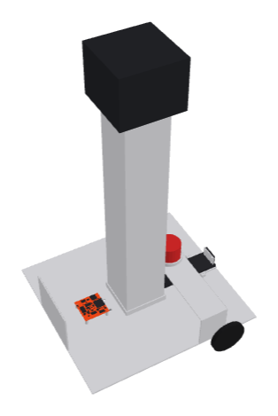
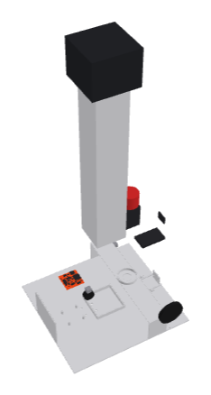
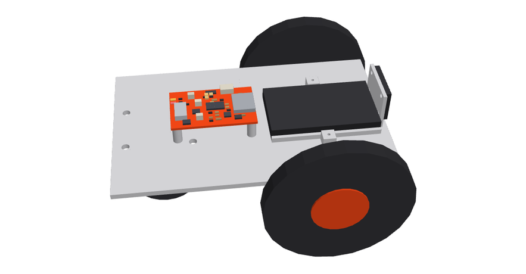
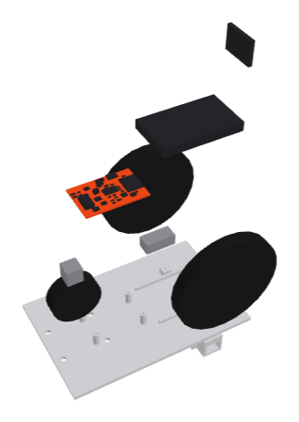
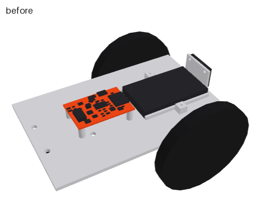
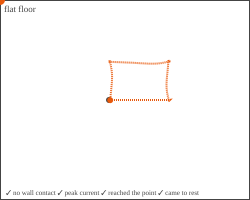
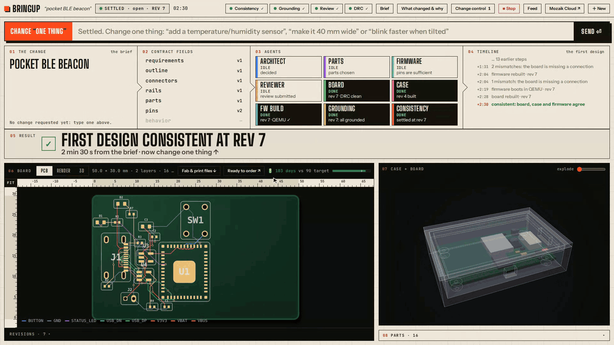
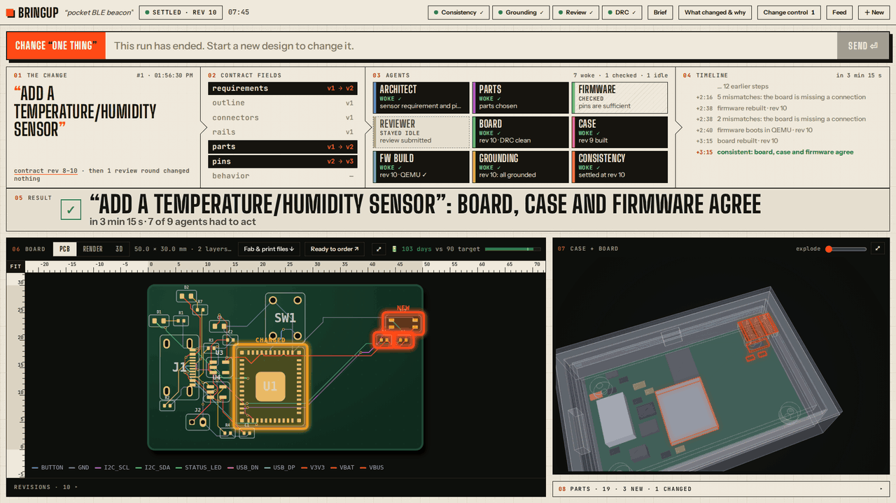
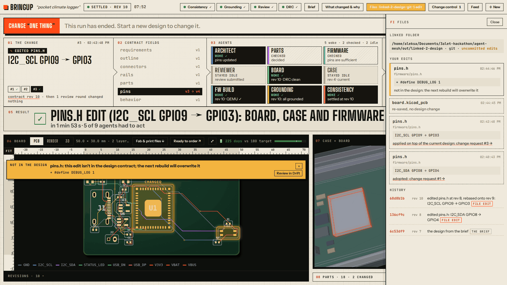
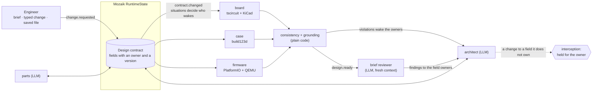

# Bringup in depth

Everything the [README](../README.md) leaves out: robots in detail, what is real and what is scripted, the quick look,
the features one by one, the architecture and the honest status. Commands and the run folder: [details.md](details.md).

## Robots

Describe a robot and Bringup's concurrent [Mozaik](https://www.npmjs.com/package/@mozaik-ai/core) agents (electronics,
mechanics, firmware, parts, each a Mozaik participant) design all of it, in parallel, against one shared contract: the boards (motor drivers, the
power tree from the pack, an IMU, servo outputs), the printed chassis and mounts, the firmware (odometry, go-to-point,
stop for an opponent, a match timer), the parts list with live LCSC stock, a ROS 2 package, and a build package with
the assembly steps. A change to any of it (a bigger pack, encoders, a servo) wakes only what it affects.

<p>


</p>

<sub>Real run 20b's Eurobot base, as designed and assembled, then exploded (captured by
<code>npx tsx scripts/readme-images.ts &lt;run folder&gt; &lt;name&gt;</code>).</sub>

- **The Eurobot base** (`briefs/eurobot-base.md`, the Eurobot 2026 rules): an ESP32-S3 (moved up from the C3 by code
  when the encoders needed more pins), wheel encoders in quadrature, an IMU, an emergency stop and a pull-cord start,
  checked against the rules (start perimeter, height, battery). A real-model run (20b) settled and passed its brief
  review.
<p> </p>



<sub>A change on a robot: "make it 2 cm wider" woke the mechanics agent and the chassis and drive builders; the board,
the firmware and the other agents stayed idle; it settled again with its drive passing (recaptured by
<code>npx tsx scripts/readme-images.ts --change &lt;run before&gt; &lt;run after&gt; &lt;name&gt; "&lt;change&gt;"</code>).</sub>

- **The rover** (`briefs/rover.md`): the reference robot. Its build package (rover-9) prices the whole robot, board
  and bought parts, with the assembly steps.


<sub>The Eurobot base's S3 firmware in QEMU driving the MuJoCo model: a 600 × 400 mm lap by odometry and the gyro, the
axle's middle drawn as it went (recaptured by <code>npx tsx scripts/readme-images.ts --drive &lt;drive folder&gt; &lt;name&gt;</code>).</sub>

- **Simulated as built**: the robot's own firmware runs in Espressif's QEMU (RISC-V for the C3, Xtensa for the S3) and
  drives a MuJoCo model of the chassis, with the gyro and the encoders it really has. The Eurobot base's S3 drives a
  600 × 400 mm lap and ends 12 mm from its start; its ROS 2 package passes its acceptance test on that simulation.
- **Checked in code**: motor stall current against the driver, the pack's current against its connector, the power
  tree from the pack's voltage, parts that collide in 3D, the drive's clearance to the walls.

Honest status: no robot board has been built yet (a prototype order is planned); the physics and the gyro's noise are
estimates; a diagonal go-to still ends 22 mm off (20 allowed). Details: [docs/mechanics.md](mechanics.md),
[docs/system.md](system.md).

```bash
npm run setup -- --robotics                       # adds QEMU (C3 and S3) and MuJoCo to the toolchain
npm run bringup -- briefs/rover.md --mock         # the rover: board, chassis, firmware, simulated drive
npm run bringup -- briefs/eurobot-base.md --mock  # the Eurobot base on the ESP32-S3
```

## What's real, what's scripted

| Part | In the quick look | In the recorded runs (`docs/runs/`) | On the live site | Locally, fully installed |
|---|---|---|---|---|
| Agents | scripted | scripted (most) · real models (`real-*`, `add-sensor-real*`) | scripted | scripted or real models (your key in `.env`) |
| Board, case, firmware builds | stubbed | real tools | real tools (recorded) · stubbed (Try it) | real tools |
| Checks (consistency, grounding) | real | real | real | real |
| Final brief review | scripted | scripted or a real model | scripted | scripted or a real model |
| The ESP32 board | none | bench runs only | none | `--bench real` |

## Quick look (Node 24 only, no API key, about 1 min)

```bash
git clone https://github.com/Laki4Ever79/bringup && cd bringup && npm ci
npm run bringup -- briefs/logger.md --mock --no-hardware --out out/quick
cat out/quick/report.md   # "settled ... Violations: 0", plus the change requests held by interception
```

This quick look stubs the hardware tools, so it builds no board or case. To see what the real tools produce without
installing them, open the recorded run [docs/runs/add-sensor/](runs/add-sensor/): the
[board render](runs/add-sensor/board/rev-10/board.png), the printable [case](runs/add-sensor/enclosure/rev-9/case.stl)
and [lid](runs/add-sensor/enclosure/rev-9/lid.stl) (GitHub shows them in 3D), the
[report](runs/add-sensor/report.md) and the full trace.

**Words used below.** *Contract*: the one shared design every agent reads and writes. *Settled*: every built file
matches the contract and nothing is left to do. *Grounding*: checking every part and pin against the parts catalog and
KiCad's symbol library. *Brief reviewer*: an AI that judges the finished design against the original brief, with none
of the agents' history.

## What it does

### 1. A brief becomes a whole design



Nine participants, each its own Mozaik loop, work at the same time against **one live design contract**: parts with
LCSC numbers, a routed KiCad board, a printable case and lid, and firmware for the real pin map, booted in QEMU.

### 2. Change one thing, and only what it affects wakes up



"Add a temperature/humidity sensor": the parts agent added the SHT40, the architect wired it, the board re-routed, the
firmware switched on its driver, and **the case cut a vent over the sensor**. 7 of 9 agents woke, 9 mismatches were
caught live, and the design was consistent again in 195 s (`docs/runs/add-sensor/`, scripted agents, real tools).

### 3. Or just edit the files yourself



Save an edited `pins.h` or the board in KiCad, and the save becomes a change request: the rest of the design follows. A
linked folder is a git repo with one commit per settled revision; an edit the contract can't hold is flagged, never
silently overwritten (`docs/runs/file-sync/`, `docs/runs/linked/`).

### 4. All the way to a real board, and ready to order

"Blink faster when tilted" changed only the firmware; the real board was reflashed in 16 s and, tilted, blinked at
**244 ms measured** against the 250 ms asked (an ESP32-S3 dev board standing in for the design's ESP32-C3). Every run
hands you case and lid STLs, a JLCPCB fab package and firmware; on a fully green run, **Ready to order** zips exactly
the files JLCPCB asks for and opens the quote page (nothing is uploaded or ordered).

### 5. An on-device model is one more domain that follows

"Add a wake word" asks only for a model. The checks carry it through the rest of the design:

- the parts add a microphone, and the board places it on the maker's land pattern
- the case gets an opening under the sound hole
- the firmware reserves the model's memory, so `pio` counts it
- power moves to USB, because always-on listening breaks the battery target

The model is tied to the sensor path its data was recorded on. A later change such as "make it 40 mm wide" moves the
microphone, and the ml agent marks the data as needing re-recording. Bringup also generates the data-collection
firmware, and checks a TFLite int8 model against the board (`bringup verify-model`). Details:
[docs/edge-ai.md](edge-ai.md).

### 6. So does the production test

"Add a production test fixture" wakes a test agent, which owns the test: which nets get a test pad, and the current
a good board stays under. The board gets pogo pads on its underside, and a test kit is built beside it: a printable
bed-of-nails fixture, factory-test firmware and a test plan with pass limits. "Add a wake word" adds mic pins, and the
test agent gives them pads. "Make it 40 mm wide" moves the pads, and the fixture's holes move with them. Details:
[docs/test-kit.md](test-kit.md).

On an existing KiCad repo, the `adopt` GitHub Action can now comment on a pull request with its change impact: what
the change moved, and which of board, case, firmware and BOM must follow, down to the firmware line
([docs/adopt.md](adopt.md)). And a part out of stock gets options, not an automatic change: other suppliers first,
then a catalog drop-in with what switching would change.

### 7. Ask for the case you want

"Add wall-mount tabs", "engrave "BRINGUP" on the lid", "add a cable gland": a case designer agent owns the case's
walls, height and added features, and the case is rebuilt around the board with them. Each feature is measured on the
built solid. A case change that needs a different board ("make the case 50 mm wide" means a 37.1 mm board, since the
module's antenna hangs past the board's edge) never
happens silently: you get a warning that the PCB will change, and it goes ahead only if you approve it. Details:
[docs/case-editing.md](case-editing.md).

Board and case are compact by default: code computes the smallest board the parts place on, and anything more than
15% over it needs a recorded reason (your size, usability, a standard fit, function, assembly and test, expansion, or
a measured routing failure). The report says what the size costs. A board that fails KiCad's DRC, or that the
router can't finish, wakes the architect to give it room. The ESP32-C3 module sits at the board edge opposite the
USB-C port, its antenna hanging past the edge as Espressif recommends; the case and the test fixture leave it room.
Rules and sources: [docs/space-rules.md](space-rules.md).

### 8. And how it connects

"Show the readings in Home Assistant": the connectivity engineer adds BTHome to the Bluetooth broadcast, and Home
Assistant picks the device up with no app. "Send them over Wi-Fi every hour": the firmware switches to Wi-Fi and MQTT
with Home Assistant discovery. The checks then follow the radio: Wi-Fi's 350 mA transmit peak raises the rail, the
hourly uploads break the 180-day battery target until they're stretched, and field updates cost a second firmware
slot that a bigger model may not fit. Details: [docs/connectivity.md](connectivity.md).

No case, or your own: "bare board, no case" builds and checks no case, and "it goes into our own housing" writes
`interface.md` (outline, mounting holes, openings, lights, vents, antenna keep-out, label) instead. What Bringup adds
without being asked (a case nobody mentioned, USB wake, recovery pads, a battery assumption) is listed in the report
under "Added for you", with how it shows and how to turn it off.

### 9. Several boards, one system

`npm run bringup -- system briefs/systems/logger-beacon-uart.json` designs each board in its own run, in parallel,
and joins them with UART or I2C links over a 4-pin JST SH cable. Each board gets one extra field, its side of each link;
its own agents add the connector and pins. Code then checks the boards against each other: TX meets RX through the
cable, matching speeds, one I2C controller, unique addresses, one set of pull-ups, the cable's length and voltage drop,
and one message definition on both sides. Out come the cable drawing, a WireViz file and a shared message header, and
each UART link's two firmwares are run together in QEMU over a virtual cable. Details: [docs/system.md](system.md).

### 10. Any vendor's MCU, chosen on equal terms

Chip facts are data, not code: each MCU has a profile (`catalog/mcu/`) with its pins, the signals each pin can carry,
peripherals, reserved pins, support parts, currents, firmware target and simulator. STM32 profiles are generated from
ST's open pin data. The parts agent ranks every chip on the same terms (`compare_mcus`), a pin solver assigns pins and
peripheral instances the way CubeMX would, and the board, firmware, simulation and checks follow the chosen chip.
`npm run bringup -- briefs/logger-stm32.md --mock` runs the whole pipeline on an STM32G031: an LQFP board with its
decoupling, firmware from the same template, booted in Renode. ESP32-C3, STM32 (G0, L0, F1 with its crystal, WB55),
RP2040 and nRF52840 are profiled; what each can do today is in [docs/mcu.md](mcu.md).

### 11. A part it doesn't know, it learns

When a plan needs a part the catalog lacks (a speaker, an amplifier), Bringup finds candidates at LCSC, DigiKey, Mouser
or the manufacturer, reads each datasheet with a model, and keeps a number only if it checks out: its value is in the
page's own words near where the model said, or two reads of an image-only drawing agree. Every number keeps its page and region;
a missing critical one (size, pin-out, supply limits, footprint, mount holes where the part has them) is never guessed, so the next candidate
is tried instead. Spending is capped per design run ($2 by default). The wiring of learned parts into the board and
firmware is the next step and is not built yet; see [docs/system.md](system.md#part-learner).

## Architecture



There is no orchestrator: no agent calls or awaits another. How it uses Mozaik:

- **`RuntimeState`** holds one live design contract per run; every field has an owner and a version.
- **Situations are the dependency graph**: each participant's situations decide which changes wake it.
- **`runLoop`** is fire-and-forget, so every agent turn runs concurrently with the others.
- **`InterceptionHandler` is change control**: a change to another owner's field is held mid-loop until the owner decides,
  and owners do say no: in real run 7 interception held 18 changes and the owners rejected 8 ([docs/runs/real-7](runs/real-7/report.md)).
- **Plain-code participants** (builders and checks) and a custom `InferenceRunner` (`--mock` runs with no key).

Events, checks, the full Mozaik table and our 4.1 workarounds (#113, #114, #115) are in [docs/details.md](details.md).

## Honest status

- Scripted runs settle with 0 violations and take mid-run changes, with the real board, case and firmware tools.
- Real models take mid-run changes too (run 20: a sensor swap rippled to consistent in 75 s, 40 mm wide in 28 s;
  that run as a whole then failed the final review and did not settle).
- **A real-model run has passed the final brief review.** We used the night's real-model runs to find and fix general problems (the designers now see the same computed facts as the reviewer, and the review's computable checks run live during design). After those fixes, run real-pass ([docs/runs/real-pass](runs/real-pass/)) designed the beacon from its brief with real models and real tools, failed review 1, fixed itself and passed review 2 (settled at rev 19, 0 violations, about 8 minutes). Each real run tonight surfaced a concrete blocker, and each fix removed it for every run after it; that is how this run got through. A few known blockers remain (a lower-dropout regulator for the parts catalog, a longer advertising window, clearer battery assumptions), and each one removed should raise the pass rate further.
- Boards need a human review before ordering (`fab/README.txt` lists every item); the parts catalog is small.
